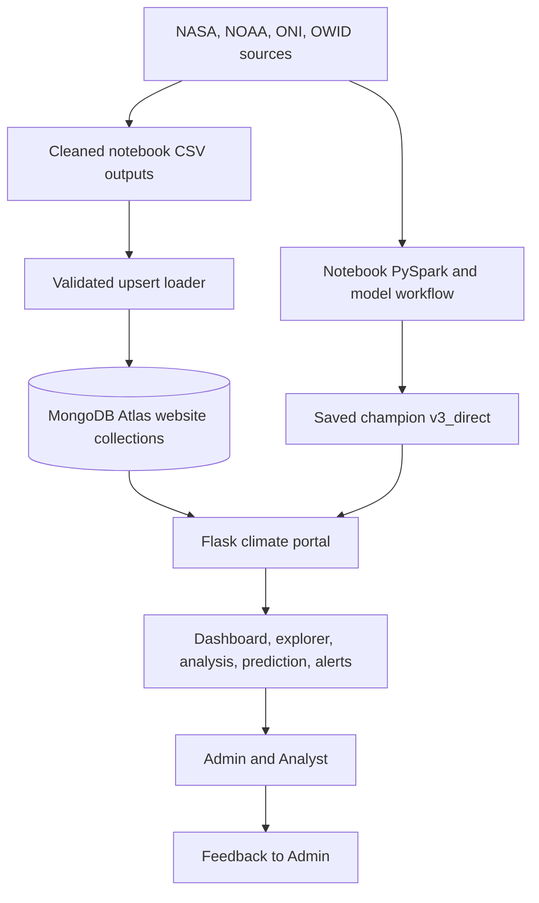
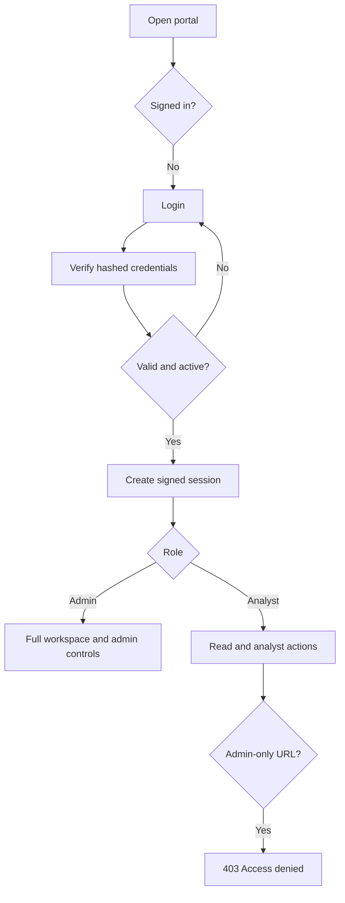
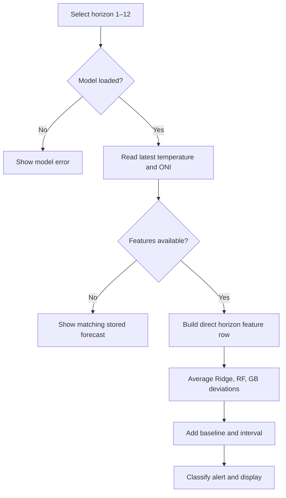
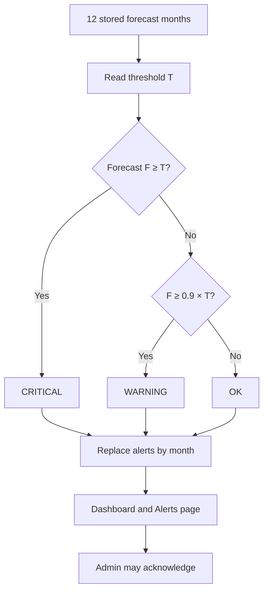
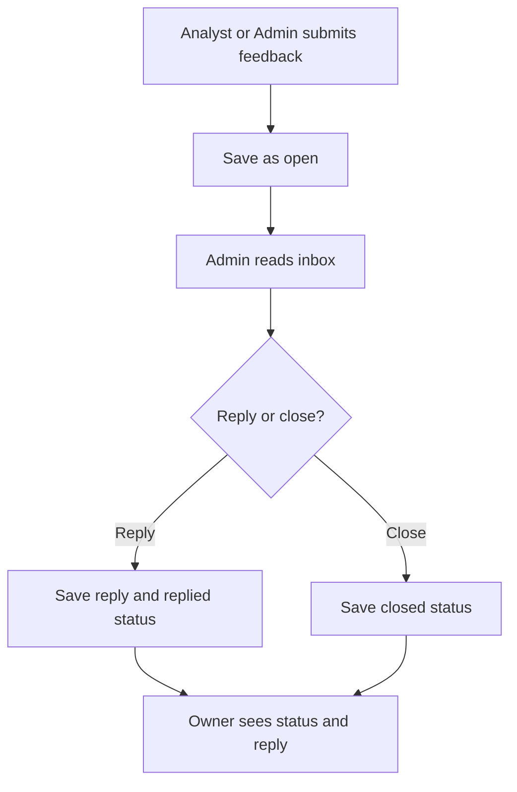
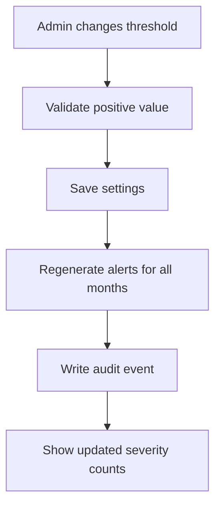
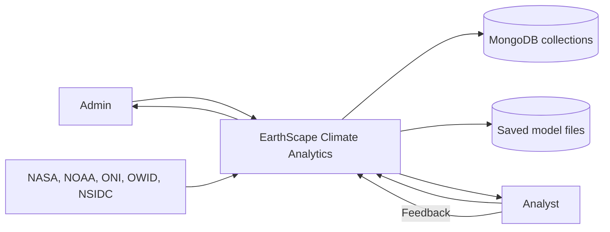
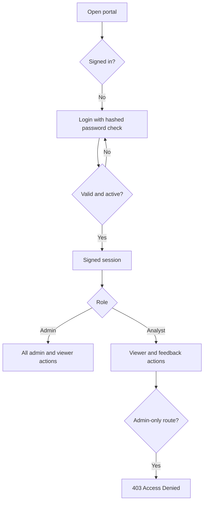
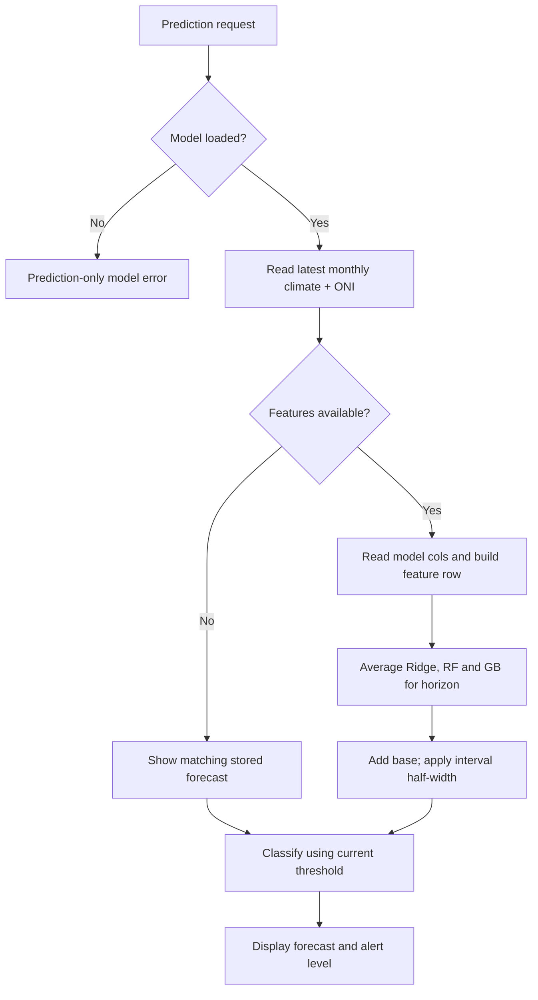
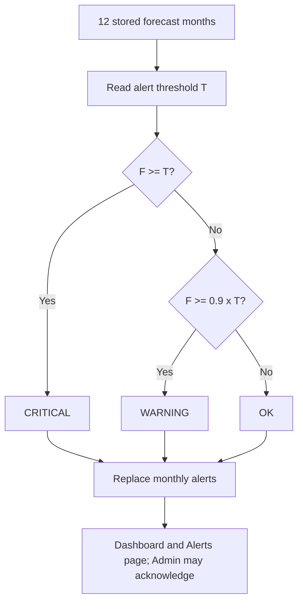

# EarthScape Climate Agency

EarthScape is a Flask and MongoDB web portal for the climate analysis completed in the companion notebook. It presents cleaned monthly temperature, CO₂ and ONI records; annual greenhouse-gas data; the saved `v3_direct` forecast model; alerts; and support workflows. It does not process raw satellite imagery or run the Spark notebook jobs from the website.

## Features and roles

| Capability | Admin | Analyst |
|---|---:|---:|
| Dashboard, historical explorer, analysis, live replay | View | View |
| Generate prediction, view forecast/model performance/alerts | Yes | Yes |
| Submit feedback and see own replies | Yes | Yes |
| Change threshold, manage users, manage all feedback, acknowledge alerts, request retrain | Yes | No |
| System health | Yes | No |

All role restrictions are enforced by Flask route decorators as well as the menu. Passwords use Werkzeug hashes. POST forms use CSRF tokens.

## Technology and folder layout

- Python 3.10+, Flask/Jinja2, PyMongo, MongoDB Atlas
- Bootstrap 5, Chart.js 4, HTML/CSS/JavaScript
- Saved scikit-learn deployment files, loaded once at app import: `model/direct_models.pkl` and `model/metadata.json`
- MongoDB database: `earthscape`
- The website reads the cleaned notebook CSV exports. It never recreates/retrains the model.

```text
earthscape_website/
├── app.py, config.py, db.py, alerts.py, model_loader.py
├── model/                         # supplied direct model + metadata
├── scripts/                       # CSV loader, first-user seed, JSON backup
├── data/cleaned/                  # user-provided notebook CSV exports
├── templates/                     # public home, login, dashboard and app pages
├── static/css/style.css
├── static/js/charts.js
├── requirements.txt
├── .env.example
├── README.md
└── USER_GUIDE.md
```

## Requirements and installation (Windows)

1. Install Python 3.10+ and create a MongoDB Atlas database user with access to the `earthscape` database. Atlas SRV connections use TLS in transit.
2. In PowerShell, enter the `earthscape_website` directory and set up the environment:

```powershell
py -3.10 -m venv .venv
.\.venv\Scripts\Activate.ps1
python -m pip install --upgrade pip
pip install -r requirements.txt
if (-not (Test-Path .env)) { Copy-Item .env.example .env }
```

3. Edit `.env` locally. Set a new `SECRET_KEY`, the rotated Atlas `MONGO_URI`, and unique admin and analyst credentials (at least 12 characters). Never commit `.env` or paste the URI into source code.
4. Copy the saved `direct_models.pkl` and `metadata.json` into `model/` if they are not already there. The provided `v3_direct_20261118_1335` folder contains these two files; they match the model files shipped in `model/`.
5. The supplied NASA, NOAA MLO, and OWID source files are in `data/source/`, and their cleaned exports are already in `data/cleaned/`. To regenerate the exports after replacing a source file, run:

```powershell
python scripts/prepare_data.py
```

This creates `monthly_climate.csv` (`year,month,temp_anomaly,co2_ppm,oni,is_anomaly,anomaly_method,source`), `annual_ghg.csv`, `arctic_ice.csv`, and `forecast.csv` from the supplied NASA, NOAA MLO, NOAA CPC ONI, OWID, and NSIDC files plus the executed notebook forecast output. ONI is aligned by calendar month and forward-filled by at most three months, matching the supplied notebook. Anomaly flags use robust-z scoring of residuals from the trailing 12-month temperature level, compared with the previous 120 months; no model is retrained. Invalid rows are reported and skipped. The data loader uses natural-key upserts, preserves missing optional values as null, and records each import in the audit collection to invalidate in-memory app caches without expanding the settings schema. See [data/cleaned/README.md](data/cleaned/README.md) for field definitions.

6. Load data and create initial accounts:

```powershell
python scripts/load_data.py
python scripts/create_admin.py
```

The first account script creates an Admin from `ADMIN_USERNAME` and `ADMIN_PASSWORD`. It also creates the optional demo Analyst from `ANALYST_USERNAME` and `ANALYST_PASSWORD`. Existing accounts are left unchanged; passwords are not printed.

7. Start the local app:

```powershell
python app.py
```

Open `http://127.0.0.1:5000`. For production, run Gunicorn behind a TLS reverse proxy, use `FLASK_ENV=production`, and set a strong `SECRET_KEY`.

## MongoDB document schema

| Collection | Natural key / fields |
|---|---|
| `monthly_climate` | One per year+month: `year`, `month`, `date` (`YYYY-MM-01`), `temp_anomaly`, `co2_ppm` (null before 1958), `oni`, `is_anomaly`, `anomaly_method`, `source` |
| `annual_ghg` | One per country+year: `year`, `country`, `co2_emissions`, `total_ghg`, `methane`, `nitrous_oxide`, `source` |
| `arctic_ice` | One per month: `month`, `extent_million_km2`, `source` |
| `forecast` | One per `month`: `month`, `forecast`, `lower`, `upper`, `model_version`, `generated_at` |
| `alerts` | One per forecast month: `month`, `forecast_value`, `threshold_used`, `level`, `message`, `created_at`, `acknowledged` |
| `users` | `username`, `password_hash`, `role`, `full_name`, `email`, `is_active`, `created_at` |
| `feedback` | `user_id`, `username`, `category`, `subject`, `message`, `status`, `admin_reply`, `created_at` |
| `settings` | One `key: alert_threshold` document with `value`, `updated_by`, `updated_at` |
| `audit` | `username`, `action`, `details`, `timestamp`; includes login, logout, admin actions and request timings |
| `analysis_results` | Optional notebook-produced summary document with `key: latest`; the Analysis page uses SRS reference values when this summary is absent |

Indexes cover monthly dates/natural keys, annual country/year, Arctic ice, forecast and alert months, usernames, feedback ownership and audit time. `analysis_results` is optional and read by its key; large Parquet/NetCDF files remain outside MongoDB, which stores only website-ready rows.

## Verified model and forecast

The model is a direct ensemble, one model set per horizon (1–12). Each set averages Ridge, Random Forest and Gradient Boosting outputs. The model stores the feature columns and interval half-widths; the app reads both from the pickle. The horizon-1 evaluation is RMSE 0.101, R² 0.701, skill vs persistence +0.204 and interval coverage 90.6%. The metadata file itself does not contain evaluation metrics; these verified figures come from the supplied SRS.

| Month | Forecast °C | Lower | Upper |
|---|---:|---:|---:|
| 2026-11 | 1.501 | 1.335 | 1.667 |
| 2026-12 | 1.540 | 1.334 | 1.747 |
| 2027-01 | 1.527 | 1.295 | 1.758 |
| 2027-02 | 1.496 | 1.263 | 1.729 |
| 2027-03 | 1.476 | 1.242 | 1.709 |
| 2027-04 | 1.393 | 1.160 | 1.626 |
| 2027-05 | 1.356 | 1.123 | 1.589 |
| 2027-06 | 1.345 | 1.111 | 1.580 |
| 2027-07 | 1.348 | 1.101 | 1.594 |
| 2027-08 | 1.332 | 1.079 | 1.585 |
| 2027-09 | 1.345 | 1.092 | 1.598 |
| 2027-10 | 1.353 | 1.099 | 1.606 |

All temperature values are anomalies in °C on the NASA GISTEMP 1951–1980 baseline. NOAA CO₂ is in ppm. The default alert threshold 1.50 °C on this scale is about 1.73 °C above pre-industrial; the Paris 1.5 °C limit above pre-industrial is about 1.27 °C on this scale.

Alert rule: `F >= T` is CRITICAL; else `F >= 0.9 × T` is WARNING; otherwise OK. At `T=1.50`, expected counts are 3 CRITICAL, 5 WARNING and 4 OK.

## Data and processing assumptions

- NASA GISS monthly temperature is a processed satellite + weather-station tabular product; the website does not claim raw satellite-image processing.
- NOAA Mauna Loa CO₂ and CPC ONI are stored in the monthly climate collection. OWID annual emissions are stored in `annual_ghg`.
- PySpark + Spark SQL with partitioned Parquet are the accepted notebook-side alternative to Hadoop/HDFS/MapReduce/Impala; Hadoop installation is not required by the web app.
- Chart.js provides the Tableau-style dashboard. RStudio is not used; analysis is in Python. JSON and NetCDF-derived tabular exports can be added by extending the loader mapping.
- The Live Monitor replays stored months and quarantines a sudden point-to-point jump for demonstration. It does not call an external live API.
- The Flask retrain control only records an Admin request. Actual training and champion/challenger evaluation stay in the offline notebook.
- Nature photography in the landing/dashboard design is loaded from Unsplash URLs; the website remains functional if an image host is unavailable.

## Security, reliability and scaling

- Keep Atlas URI, `SECRET_KEY`, and seed passwords in `.env`; `.env` is git-ignored. The example file contains placeholders only. Never log a password or connection string.
- Atlas provides encryption at rest; its SRV connection uses TLS in transit. Store only account data needed for access and user-owned feedback. Analysts can read only their own feedback; Admin routes are role-protected.
- Use a strong random secret, HTTPS in production, secure session cookies, and unique account passwords. Change seed passwords after first sign-in.
- Target 99% availability during demonstration periods; communicate maintenance in advance. If MongoDB is unavailable, protected pages show a friendly retry message. A missing model disables prediction only.
- Enable Atlas automated backups/snapshots in the Atlas cluster settings when the selected tier and cost are acceptable. The reviewed Atlas change would move this project from Free to AWS M30 ($0.51/hour) plus backup storage, so it was cancelled; the current cluster therefore has no Atlas snapshots enabled. Make an additional local JSON export with `python scripts/export_backup.py`; run it on a regular schedule and store copies separately from the application host.
- The application uses signed client-side sessions and can run as multiple Flask/Gunicorn instances behind a TLS reverse proxy/load balancer. MongoDB Atlas cluster capacity can be scaled separately.

## SRS traceability

| SRS item | Implementation |
|---|---|
| FR-1 Auth/RBAC/audit | `/login`, `/logout`, `login_required`, `admin_required`, `audit`, hashed users |
| FR-2 Ingestion | `scripts/load_data.py`: CSV validation, row reports, natural-key upserts, source labels |
| FR-3 Storage | Nine website collections and indexes in `db.py`; optional `analysis_results`; model/large files remain files |
| FR-4 Processing display | `/analysis`: Spark summary, correlation, residual metrics/months, ONI, Arctic/Tropics/sea-ice results |
| FR-5 Simulated live | `/live`, `/api/live_data`; replay chart and quarantine queue; no external live API |
| FR-6 Prediction/models | `/predict`, `/forecast`, `/models`; pickle loaded once, selected horizon, ensemble + interval, fallback to stored output |
| FR-7 Visualization | `/dashboard`, `/api/chart/history`, `/api/chart/forecast`; KPI, history, CO₂, comparison, forecast and annual GHG charts; filters and line/bar toggle |
| FR-8 Alerts | `alerts.py`, `/alerts`, `/threshold`; regenerated after threshold change, Admin acknowledgement, color-coded levels |
| FR-9 Feedback | `/feedback` user-owned inbox; `/admin/feedback` status filtering/reply/close |
| FR-10 Deliverable support | This README, `USER_GUIDE.md`, test-data description and demo script below |
| NFR-1 Performance | Startup model loading, indexes, paginated explorer, bounded lists, chart JSON APIs, process-local KPI/forecast cache invalidated by data revision and threshold |
| NFR-2 Monitoring | `/health`, recent audit timings/actions on model page |
| NFR-3 Security | Environment-only secrets, password hashes, CSRF, server-side roles, input bounds |
| NFR-4 Reliability | Friendly database/model errors, Atlas backup note, local JSON export script |
| NFR-5 Scalability | Signed stateless sessions, Gunicorn/reverse-proxy and Atlas scale guidance |
| NFR-6 Compliance | Source units/baseline labelled; data loader separated from web routes |
| NFR-7 Documentation | Installation, assumptions, schema, FAQ/user guide, flows and traceability |
| NFR-8 Usability | Responsive Bootstrap layout, role badge, flash feedback and consistent alert colors |

## Test data and acceptance checklist

The supplied training sources include 1,762 NASA temperature months (1880–2026), 823 NOAA MLO CO₂ observations, and the original OWID file (56,269 rows × 79 columns). The app-ready OWID output contains 44,008 country/year rows with CO₂ or total GHG. CPC ONI supplies 921 months through 2026-09 plus the notebook's one-month forward fill; NSIDC adds 576 Arctic extent months. The model's ONI lag features are populated. Its verified 12-month output is tabulated above. At threshold 1.50, the stored forecast yields 3/5/4 alert counts. The seeded demo usernames are `earthscape_admin` and `earthscape_analyst`; their passwords are read from local `.env` and are never printed by the seed script.

Acceptance walkthrough: Admin sign in → dashboard charts → run horizon prediction → change threshold and inspect regenerated alert counts → acknowledge an alert → reply to feedback → view health → log out → Analyst sign in → submit feedback → attempt `/threshold` and `/users` and receive 403. Also check the stored forecast table, missing-model prediction message and friendly database-disconnected page.

## Demo video outline

1. Sign in as Admin; tour overview and source units.
2. Run a prediction and show the interval, then open the 12-month forecast.
3. Change the threshold; show the new alert levels and counts.
4. Reply to a feedback request and show the health page.
5. Log out; sign in as Analyst; submit feedback and show the blocked threshold page.

Recorded walkthrough: [`deliverables/demo_walkthrough.mp4`](deliverables/demo_walkthrough.mp4). It demonstrates the Admin dashboard, a live prediction, forecast, threshold change and regenerated alerts, analysis/model pages, feedback reply, then the Analyst feedback flow and blocked Admin-only threshold route. The demo threshold and temporary feedback are cleaned up after recording; the stored threshold is restored to 1.50 with 3/5/4 alert counts.

Responsive browser QA: every Admin page was opened at 1440, 1024, 768, and 390 px widths; every Analyst page was opened at 390 px. No horizontal overflow or route failures were found. Dashboard screenshots are in `deliverables/qa/`.

## Flow diagrams




















